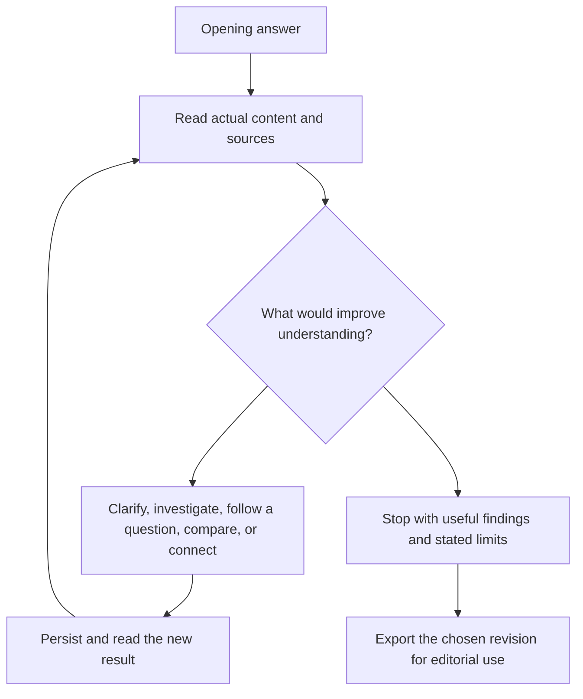

# RationalGrid MCP: adaptive research and engaging publishing

Status: proposed implementation specification. Updated 16 November 2026.

Audience: RationalGrid and Publishing Studio maintainers. This document proposes work;
it does not enable publication commands or change running campaigns.

## 1. Intended result

A weekly brief should produce a varied set of worthwhile explorations, each with enough
specific, traceable material to make a good post. The workflow should retain its progress,
recover individual failures, and publish the intended grids without manual toggles.
One review of the finished weekly package should normally be sufficient.

Success has two dimensions:

- **Less production effort:** fewer repeated calls, manual repairs, publication steps,
  duplicate generations, and browser-dependent operations.
- **Better material:** recognisable subjects, concrete scenes, surprising but defensible
  tensions, varied structures, clear reader payoffs, and honest qualifications.

More generated nodes, longer answers, more disagreement, and more synthesis are not
quality measures. The system should stop when it has something worth communicating.

## 2. What already exists, and what caused the repetition

The following baseline was checked against the current source in the adjacent
`dialectic` repository and this Publishing Studio, rather than inferred from the UI.

| Capability | Current position | Required action |
| --- | --- | --- |
| Adaptive opening | `explore_question(strategy=adaptive)` already creates an opening question and answer. Its completion covers that step only. | Use it with a durable client controller now; do not mistake it for an autonomous whole exploration. |
| Free-form thinking tools | Node reads, exact-passage targeting, learning plans, follow-up questions, counterexamples, assumptions, evidence checks, implications and multi-node synthesis already exist. | Adopt them; extend orchestration rather than duplicate these tools. |
| Fixed overview | `strategy=guided` runs opening → testing → deepening → synthesis. | Preserve as an explicit compatibility option. Remove it as the weekly production default. |
| Current Studio behaviour | `Explorations.start/1` explicitly requests `guided`; `Weekly.SourceSelector` prefers synthesis; `Weekly.Editor` requires exactly three video beats and one argument pattern. | Change all three choices. A server-only change will leave much of the repetition intact. |
| Durable reads and operations | Current server source includes canonical node serialization, content status, revision-bound reads and retained operation receipts. | Test the deployed contract and make the client consume these fields. Do not reimplement them as missing features. |
| Errors and limits | Structured errors and `get_server_capabilities` already exist. The client still interprets some human error text. | Consume typed errors and advertised limits. |
| Visibility and recovery | Current capabilities report publication, batch execution, notifications and stage recovery as unsupported. | Add these incrementally, starting with visibility. |

The 16 November run illustrates both problems. Sixty posts were delivered, but generated
copy needed direct editing for scaffolding, unfinished text and overstatement. Publishing
Beauvoir's grid during the guided run stopped its coordinator after two answers; separate
append operations were needed to complete the analysis. These are observed workflow
problems, not evidence that a different format will automatically improve engagement.

Relevant source: `dialectic/mcp/src/server.ts`,
`dialectic/lib/dialectic/integrations/{explorations,grid_content,mcp_capabilities}.ex`,
and this repository's `rational_grid/explorations.ex`, `weekly/source_selector.ex`,
`weekly/editor.ex` and `weekly/services.ex`.

## 3. Ownership of the changes

| RationalGrid / MCP server | Publishing Studio | Shared contract |
| --- | --- | --- |
| Graph generation, node tools, source references, visibility, persisted revisions, operation receipts, capacity and recovery | Weekly selection, channel-specific writing, format selection, rendering, Buffer delivery and performance measurement | Editorial brief, stable source identities, run provenance, quality issues and revision hashes |

Keep Buffer accounts, platform queue rules and channel copy templates out of RationalGrid's
core MCP interface. RationalGrid supplies useful research; the Studio decides how to
present and distribute it. Performance context can be attached to a research brief, but
the server should not require a social account to explore a question.

## 4. Visibility commands and publication without interruptions

### 4.1 Add `set_grid_visibility`

Use a setter, not a toggle, so an uncertain retry cannot reverse the intended action.

```json
{
  "grid_id": "example-grid",
  "visibility": "public",
  "expected_revision": 42,
  "request_id": "6e8115f4-d186-45f0-a549-e9713e18e75d"
}
```

The same tool accepts `visibility: "private"`. `grid_id`, `visibility` and `request_id`
are required; `expected_revision` is required when making content public and optional
when making it private. Require current ownership and a dedicated `grids:visibility`
OAuth scope. Existing create/read/append grants must not silently gain
this scope. Request it once when the user enables publication automation. A client's
existing authority to create grids alone does not grant publication authority.

Return an operation receipt with the requested visibility, committed content revision,
visibility version, canonical URL, application state, and anonymous-access verification
state: `pending`, `verified`, or `failed`. A publication accepted for propagation is not
yet a verified public destination. A historical receipt is not proof of current visibility.

Rules:

1. Validate access, then resolve an existing idempotency receipt before checking a new
   revision precondition. Exact replay returns the original result; changed arguments
   under the same UUID return `request_conflict`.
2. A fresh public-setting request with a stale revision returns `stale_revision` and makes
   no change. The client re-reads before issuing a new publication intent.
3. By default, reject publication while an exploration is actively writing, with
   `generation_in_progress` and resumable operation references. Offer deferred publication
   through the run policy below. Apply this rule in the shared domain layer, including UI
   publication, rather than only in the MCP wrapper.
4. Making a grid private takes effect without waiting for generation. It also cancels
   pending automatic publication intents, so a late worker cannot make it public again.
5. Invalidate public reads, legacy public exports, search exposure and applicable caches
   on a private transition. Report propagation truthfully. Previously downloaded copies
   and social posts cannot be recalled by changing grid visibility.
6. Content permission, visibility and editing locks are separate concepts. A visibility
   change must not destroy generated work or silently change its ownership.

Use a separate visibility version for publication intent and cancellation; changing
visibility alone should not invalidate content hashes or force image/video rendering.

### 4.2 Deferred publication policy

New autonomous runs accept an explicit publication policy, defaulting to `keep_private`:

```json
{
  "mode": "public_on_success",
  "allow_partial": false,
  "expected_visibility_version": 7
}
```

`public_on_success` requires publication authority and saved, bounded user intent. After
generation, persist and validate the chosen revision, then apply publication to that
revision. Record publication as a separate operation. Publication failure must not relabel
successful research as failed or regenerate its answers.

An explicit private-setting request increments the visibility version and revokes pending
publication intent. Resuming research cannot restore that intent automatically.

For the initial release, publication is the last research action. A later content change
requires a new publication decision. Versioned public releases with private working drafts
are a useful subsequent extension; do not imply that model already exists.

## 5. Adaptive exploration with durable, bounded autonomy

### 5.1 Immediate client implementation using existing tools

Persist a controller that repeatedly:

1. Starts `explore_question(strategy=adaptive)` and waits for the opening answer.
2. Reads the completed content, sources and relevant neighbouring nodes.
3. Selects a useful next move, or stops. It can target an exact passage, follow a question,
   inspect evidence, clarify an ambiguity, compare readings or explore a consequence.
4. Saves the decision, target hashes and write UUID before submitting that move.
5. Reads its actual result before selecting another move.

Learning plans are optional aids. Their suggested paths are not a checklist. Synthesis is
optional, may join any relevant completed nodes, and is never required for import.
Do not generate an opposing view solely to make a graph look balanced.



### 5.2 Add a server-managed `run_exploration` tool

This moves the same controller to RationalGrid's background workers, so closing a client
does not stop the inquiry. Keep the existing adaptive step and guided tool semantics
unchanged; a distinct tool avoids another ambiguous meaning of `completed`.

Illustrative input:

```json
{
  "request_id": "0df291d7-8006-47ef-ac36-8bafc4a29820",
  "question": "Why does Zarathustra ask his disciples to leave him?",
  "goal": "Explain the tension between learning from a teacher and independent judgement.",
  "audience": "Curious readers without specialist philosophical training",
  "subject": {
    "kind": "book",
    "title": "Thus Spoke Zarathustra",
    "creator": "Friedrich Nietzsche",
    "focus": "On the Bestowing Virtue"
  },
  "source_ids": [],
  "limits": {
    "max_generated_nodes": 6,
    "max_elapsed_seconds": 600,
    "max_total_tokens": 16000
  },
  "publication": {"mode": "keep_private"},
  "client_context": {"run_id": "weekly-3", "story_id": "4"}
}
```

These are proposed initial ceilings, not current server limits. Discover supported limits
and reject unsupported fields or values rather than pretending a budget can be enforced.
Count opening answers and generated learning-plan nodes against node limits; count
planning, extraction and corrective model calls against token/cost budgets too. Report
reserved, consumed and uncertain provider usage separately.

The controller must use RationalGrid's native generation pipeline. It must not fabricate
finished nodes, source passages, citations or evidence to satisfy an intended shape.

Persist a short decision record per move: observed gap, selected tool, target node IDs and
hashes, expected contribution, resulting operation ID and outcome. This is an operational
audit explanation, not a request to expose private model reasoning.

### 5.3 Stopping and completion semantics

Stop when the goal is met, the next move would repeat existing material, a budget or
deadline is reached, or a consequential evidence gap prevents a responsible answer.
A deadline prevents new work and requests cancellation of in-flight work where supported;
late results still receive durable receipts and must not be published automatically.

Expose independent fields:

- `state`: `queued`, `running`, `paused`, `completed`, `failed`, `cancelled`.
- `outcome`: `goal_satisfied`, `bounded_result`, `insufficient_evidence`, or null while active.
- `stop_reason`: for example `goal_met`, `budget_exhausted`, `repetition`, `deadline`,
  `source_gap`, `visibility_changed`, or `user_cancelled`.
- `editorial_readiness`: `ready`, `needs_review`, `insufficient_material`.
- `result_revision`, generated-node IDs, limitations, consumed budget and recoverable steps.

`completed` means the bounded run has durably stopped and its result is readable. It does
not mean the philosophical issue is settled. A budget-limited result is not automatically
eligible for `public_on_success`; the requested goal and readiness conditions must hold.
Readers can inspect preserved partial work even when a run fails.

If an external visibility change interrupts a run, checkpoint and pause with the reason.
Continue public appends only under an explicit saved policy; never silently make the grid
private or restart it. Do not share a graph between two active autonomous controllers.

## 6. Better raw material, rather than more fluent generalities

### 6.1 Sources and attribution

Extend source references to describe works and claim support, not merely a URL and title:
author, work, edition/translator where relevant, chapter/section/page locator, source type,
retrieval time, stable source ID, access status, and the exact supporting passage hash.
Distinguish primary text, secondary interpretation and model-generated analysis.

Add a bounded `register_sources(request_id, sources)` operation for owner-provided
references or permitted excerpts. Persist submitted references once; source retrieval and
verification can be asynchronous. Require create authority for unattached owner source
records and append authority when attaching sources to an existing grid, with current
access checks. A read-only grant must not permit source registration.
Report `reference_only`, `retrieved`, `verified`, `inaccessible` or `mismatch` rather than
claiming that an uploaded citation has been checked. Enforce excerpt limits and keep
private source material out of public exports unless that material may be exposed.

Where retrieval is supported, use the source service's access restrictions and network
controls. If the text cannot be inspected, mark the limitation and avoid direct quotation.
Do not infer reproduction rights from the presence of a URL.

Direct quotations must match a retrievable or supplied passage and the stated edition.
Paraphrase, hypothetical example and textual scene must be explicitly distinguishable.
An uncited generated sentence must never become a quote card attributed to the author.

### 6.2 Claim-level editorial checks

Attach actionable issues to node IDs and passages. Check for false dilemmas, strawmen,
unsupported factual claims, invented quotations, conflation of author and character,
anachronistic framing, and unresolved distinctions that materially change the argument.
Return `supported`, `contested_interpretation`, `hypothetical` or `unsupported` per claim,
with supporting source IDs. A model's confidence score is not a verification result.

Repair the affected claim or branch once within budget. Preserve the original revision
and its provenance. Persistent uncertainty becomes a visible qualification or a request
for focused review, not an endless whole-grid approval loop.

Examples from this week's subject matter:

- Kant: explore whether care can depend on duty without claiming he forbids compassion.
- Arendt: distinguish explaining thoughtlessness from excusing guilt; preserve the dispute
  over her historical portrayal.
- Marx: separate labour-saving capacity from the conditions that determine who benefits.
- Woolf: follow a concrete scene and competing readings without manufacturing a binary
  answer or romanticising a character's suffering.

## 7. A stable editorial export

Add read-only `export_grid(grid_id, revision, profile="editorial_v1")`. Export existing,
persisted work; reading it must not start a model call. Support private grids for authorised
clients, and preserve access checks for historical revisions.

The versioned export contains:

| Field | Purpose |
| --- | --- |
| `schema_version`, `grid_id`, `revision`, `content_hash` | A stable identity and cache key |
| Complete nodes and edges, all node classes | Preserve the graph rather than flattening it to an answer and synthesis |
| Source records and claim-to-source references | Trace statements and quotations |
| `subject`, `central_tension`, `reader_payoff` | Establish what is interesting and why it matters |
| `claims`, `examples`, `competing_readings`, `qualifications`, `open_questions` | Material the Studio can use selectively |
| `recommended_node_ids` and concise reasons | Select useful material without requiring any particular node class |
| Optional framing candidates bound to claim/node IDs | Scene, misconception, consequence, contrast, or unanswered question |
| Generation origin, operation IDs, parent links and revision history | Preserve authorship and recovery provenance |
| Current visibility and publication receipt, separately timestamped | Distinguish readable private material from a valid public destination |
| Readiness, unresolved issues and field availability | Avoid filling absent fields with plausible inventions |

Persist the editorial brief during an explicit generation operation, within its budget.
For older grids, an explicit `prepare_editorial_brief(grid_id, revision, request_id)` may
create it as a separate derivation using append authority; it does not alter source nodes.
Until then, export null brief fields with `brief_status=not_prepared` and the full graph.
Mere existence of an editorial brief does not certify that a source or claim is true.

Pin paginated exports to one revision and profile. Return opaque cursors and a final
content hash; never combine pages from different snapshots. Do not require synthesis.
Expose graph changes since a known revision later, so only dependent material is rebuilt.

## 8. More engaging presentation in the Studio

### 8.1 Select an editorial lens before choosing a template

Generate a small set of grounded angle candidates, each with a concrete payoff and source
references, then choose one. Examples include a character's decision, an overlooked
qualification, a contradiction within a text, a surprising consequence, a comparison of
readings, or a common misconception. Reject near-duplicates of recent posts by meaning,
not just title. Keep the chosen angle and its reason for later evaluation.

Across a ten-story week, flag excessive reuse of an author, lens, opening phrase or
question shape. Use a configurable soft limit such as at most three stories with the same
primary lens. Treat it as a review signal, not a reason to invent a weak alternative.

Do not force every hook to be a question. A specific observation or scene can be a stronger
opening. Every post must deliver the promised insight before asking for engagement.
Avoid generic closing questions, unsupported provocations and repeated calls to debate.
Occasional prediction prompts or choices can invite participation, provided the post
also explains what the reader should learn and does not pretend a disputed reading has
one mechanically correct answer. Follow successful discussions with a deeper connected
grid or post, rather than repeatedly starting unrelated topics.

### 8.2 Vary the explanation and medium together

Support several presentation patterns: scene → interpretation; claim → counterexample;
misconception → correction; two readings with an unresolved difference; consequence
chain; argument map; short contextual explanation. These are options, not mandatory
research sequences or equal quotas.

Replace the exact-three-beat schema with a duration- and word-budgeted script. For an
initial release, permit two to five content beats while retaining the current 45-second
production ceiling and readable per-frame limits. The selected format should determine
frame count; opening, closing and repetitions count towards pacing too.

Use actual platform affordances. LinkedIn and Facebook need substantive, distinct text;
short video needs a visual progression and understandable first seconds; X needs one
clear idea; Instagram may benefit from a diagram or scene-led carousel instead of reusing
the same video every time. Test variations rather than assuming one universally wins.

Visual briefs should name concrete subjects, explain their relationship to the argument,
and distinguish documentary from illustrative assets. Verify identification before using
a stock portrait as a named thinker. Where identification is unavailable, use a relevant
book, setting, diagram or typographic treatment. Retain asset attribution and licences.

### 8.3 Enforce publishable output at the final boundary

Keep planning labels, experiment tags, production instructions and alternative hooks in
metadata, outside publishable fields. Never silently truncate a caption to meet a schema
or platform limit. Request a rewrite of the affected field or story, then check it again.

Validate actual final captions after links are appended, not just model fields. Flag
unfinished sentences, leaked scaffolding, repetitive openings, unsupported quotations,
missing subject names and over-dense slides. Mechanical checks may block delivery;
editorial heuristics should produce focused issues rather than claim perfect detection.
Allow one bounded automatic correction before review. Cache source work and unaffected
copy, and never regenerate all ten stories to repair one field.

## 9. Operations that survive a weekly run

Retain one durable receipt per write and stable step identities across restarts. Bind
idempotency to the authenticated owner, client operation and validated arguments. An
uncertain outcome means read/reconcile the same operation, not submit another grid.
Keep receipts or replay tombstones long enough to cover delayed workflow retries, and
advertise the retention period; expiry must never cause an old UUID to create new work.

Extend capabilities additively with feature/schema versions, budget support, receipt
retention and negotiated execution modes. Preserve existing structured errors and limit
fields. Add codes for visibility conflicts, source gaps and unsupported policies with
`retryable`, `retry_after_seconds`, `request_accepted`, affected IDs and recovery options.
Unknown error codes must remain displayable without unsafe retries.

New tools use these application contracts; mutations always require a persisted UUID:

| Tool | Required input / result boundary |
| --- | --- |
| `set_grid_visibility` | Grid, target visibility, UUID; public changes require a content revision. Returns a publication/visibility receipt. |
| `run_exploration` | Question, goal, UUID; optional audience, subject, source IDs, limits and publication policy. Requires create/read/append scopes, plus visibility scope only for requested publication. Returns a root operation reference and grid reference once allocated. |
| `run_exploration_batch` | Batch UUID and 1–10 independently keyed run inputs, with an aggregate budget ceiling. Returns per-item admission receipts and root operation IDs; accepted items retain the same UUID on replay. |
| `get_operations` | 1–50 owned operation UUIDs. Returns an entry per UUID, including inaccessible/unknown outcomes, without disclosing another account's operation. Requires read authority and current access. |
| `resume_exploration` | Run UUID, expected checkpoint, action and new command UUID. Actions distinguish continuation from an explicitly requested retry of a named failed step. Requires the original run's applicable scopes. |
| `cancel_exploration` | Run UUID, expected checkpoint and new command UUID. Requires ownership and append authority; returns the checkpoint and any in-flight work still being reconciled. |
| `register_sources` | UUID and 1–20 source records; optional target grid and expected revision. Returns stable source IDs and their verification states. |
| `prepare_editorial_brief` | Grid, immutable content revision and UUID. Requires read/append authority and returns a derivation operation, without overwriting graph nodes. |
| `export_grid` | Grid, revision, profile and optional cursor. Returns a versioned, generation-free snapshot or its next page. Requires access; private and historical data remain authenticated. |

Extend `get_operation` for new receipts with a discriminated, versioned result:
`schema_version`, `operation_kind`, `request_id`, `state`, `result_revision`, `result`,
`error`, `updated_at` and `next_poll_after_seconds`. Reference step UUIDs from root runs.
Keep existing tool results and legacy operation receipts compatible; their required
`node` fields must not be imposed on a visibility-only or batch receipt. Advertise the
new envelope version before clients submit these new operations.

Add `get_operations(request_ids)` and a bounded `run_exploration_batch` for up to ten
independently idempotent items. Admission can be partial but must be explicit per item;
one failed topic must not stop completed or queued siblings. The scheduler enforces
advertised account/provider capacity, budget reservations, fairness and backoff.

Add `resume_exploration` and `cancel_exploration`, each with its own UUID and an expected
checkpoint version. Resume preserves completed nodes and does not implicitly retry a
terminal generation. Return recovery options; an explicit `retry_step` action creates a
new linked attempt on the same grid. Content changed since the checkpoint requires
reassessment. Cancellation prevents new work and records the fate of in-flight results.

Use ordinary operation polling as the baseline. Add progress notifications only for
negotiated, supported requests. A progress stream attached to a completed HTTP call is
not a durable webhook. If background events are added, specify an authenticated replayable
subscription or signed webhook with event IDs, deduplication, access checks and a polling
fallback. Do not make correctness depend on receiving every event.

## 10. Finish production without keeping a browser open

This is a Studio change, not a new philosophical MCP tool. Run the existing canonical
canvas renderer in a managed browser worker, using the same fonts, templates and asset
inputs as interactive previews. Do not introduce a second renderer with different output.

Give rendering, encoding, upload and delivery separate persisted statuses and hashes.
Resume missing assets only. Invalidate dependencies precisely: a corrected caption does
not require new research; one changed frame does not invalidate every story; making a
grid public does not require rendering again. Preserve the existing Buffer send-intent
and reconciliation behaviour.

Present a single review package with previews, captions, source links and only material
exceptions. Queue-aware planning should still do no generation when queues are full.
An explicit weekly request can authorise the bounded run; do not add per-branch prompts
or a recurring subjective approval agent. Host/client approval policies remain separate
and cannot be disabled by an MCP tool description or annotation.

## 11. Learn from outcomes without chasing noisy counts

Keep the performance system in the Studio. Record the path from evidence → chosen angle →
source revision → post variant → media hash → Buffer ID. Attach a hypothesis to an
experiment, such as whether a textual scene produces more meaningful responses than an
abstract framing. Keep experiment labels out of public copy.

Capture outcomes at comparable post ages, initially 24 hours, 72 hours and seven days.
Store metric definitions, exposure denominators, missing values and measurement freshness.
Compare within a platform and format. Use saves, thoughtful comments, clicks, retention
and video completion where available, not views alone. Missing metrics are not zero.

Separate topic, hook, format and timing experiments where feasible. Rotate matched
stories between time windows rather than declare an optimal time from cumulative counts.
Report small samples and confounding. Reserve a small editorial exploration allocation
so past exposure does not make the content progressively narrower.

RationalGrid may store opaque evidence IDs and a short supplied rationale in run context.
Sending raw audience or account data is unnecessary for the first release. A future
outcome-ingestion API should accept minimal aggregate records, not require platform keys.

## 12. Compatibility and implementation sequence

### Milestone A: remove the fixed shape and manual publication

- Studio adopts existing adaptive tools with durable per-step state, all relevant node
  classes and optional synthesis. Existing guided runs finish under their original policy.
- Server adds visibility setting and deferred publication with separate receipts.
- Studio consumes typed errors, capabilities and revision-bound cursors already available.
- Copy generation permits varied structures and checks complete final text.

Acceptance demonstration: ten questions produce ten usable grids with meaningfully
different research paths; one weekly package review; no manual visibility toggles;
sixty posts enter the six queues once their destinations and media are verified.

### Milestone B: stronger sources and less unattended coordination

- Server-managed bounded adaptive runs, checkpoint recovery and cancellation.
- Source registration, claim references and versioned editorial export.
- Studio selects angles from useful passages rather than assuming the last synthesis wins.
- Canonical rendering runs in a background browser worker.

### Milestone C: better selection and measured variety

- Batch admission/status reads, incremental export and optional durable notifications.
- More visual/story patterns and semantic novelty checks across weeks.
- Comparable-age outcome snapshots and explicit topic/format/timing experiments.

Migrate new runs behind capability flags. Do not change the meaning of existing UUIDs,
switch strategies mid-run, re-publish historical grids, or reschedule existing posts.
Read-only or older clients continue to work through the existing tools and exports.
If a requested capability is absent, use an explicit fallback; never silently replace an
adaptive research request with the old fixed overview.

## 13. Acceptance tests and evaluation

| Area | Required cases |
| --- | --- |
| Visibility | Public/private transitions; ownership and scope failures; identical retry; changed-payload UUID conflict; stale revision; propagation failure; no private content through public export/cache; private-setting revokes pending publication. |
| Publication during work | UI and MCP follow the same domain rule; early publication is deferred/rejected cleanly; an external change pauses and preserves work; late workers cannot republish an explicitly private grid. |
| Adaptive paths | Fixtures justify different next moves and node counts, including a useful result with no synthesis; targets are actual node IDs/passages; changed hashes trigger re-reading; no manufactured opposition. |
| Bounds and recovery | Planning and corrections consume budget; stop on repetition/deadline; restart after any checkpoint; uncertain writes reconcile; explicit retry creates a linked attempt without a new grid; cancelled work does not silently continue. |
| Source integrity | Verified versus inaccessible references; edition mismatch; fabricated quote rejected; hypothetical distinguished from textual event; claims carry their support or a visible limitation. |
| Export | Private access; canonical content equals operation result at the same revision; cursors stay on one snapshot; every node class and multi-parent edge survives import; no synthesis required; export performs no generation. |
| Copy/media | Complete captions after links; no scaffolding or mid-sentence cuts; grounded variations; variable frames remain readable and under duration limits; only dependent outputs rebuilt. |
| Weekly run | One failed story leaves others intact; ten distinct stories, sixty matching deliveries, no duplicate UUIDs or Buffer IDs; exact destination access, media readiness, body and time checks. |
| Compatibility | Existing guided/adaptive step receipts unchanged; older clients ignore additive fields; unsupported policies fail explicitly; access is rechecked on receipt reads and recovery. |

Pilot against the current workflow using comparable briefs and record human interventions,
editing time, repeated model calls, generation cost, unsupported claims and duplicated
angles. Review a blinded sample for specificity, insight, clarity and fidelity to sources.
Then observe engagement at equal post ages. Do not claim improvement merely because a
quality model assigns higher scores or a single post receives more views.

Count an intervention as a person or assistant having to leave the normal workflow to
repair state, edit an output, replay a write or toggle visibility. Record bounded automatic
corrections separately, including their time and cost. Establish this baseline before
claiming a reduction; the existing run reports do not measure every intervention.

Suggested pilot targets: zero duplicate grids/deliveries, no per-grid publication action,
no silently clipped captions, complete provenance for publishable claims, and at least a
50% reduction in manual repair actions versus the recorded baseline. Editorial and
engagement gains remain hypotheses to evaluate, not release guarantees.

## 14. Protocol references and design boundary

The proposed application tools and fields above are RationalGrid contracts, not new MCP
standard methods. Publish input/output schemas and structured tool results through the
normal [MCP tools interface](https://modelcontextprotocol.io/specification/2025-11-25/server/tools).
Tool annotations describe behaviour; they do not grant access or override host decisions.

Use scoped OAuth challenges for added visibility authority, following the
[authorization specification](https://modelcontextprotocol.io/specification/2025-11-25/basic/authorization).
Keep scope enforcement in the server rather than relying on prompt wording.

[Progress notifications](https://modelcontextprotocol.io/specification/2025-11-25/basic/utilities/progress)
are optional and request-associated. The server currently advertises several protocol
versions, so negotiate support and retain polling. The
[2025-11-25 task specification](https://modelcontextprotocol.io/specification/2025-11-25/basic/utilities/tasks)
labels tasks experimental; support in a particular SDK/version must be verified before
adoption. The application-level operation receipts in this proposal do not depend on it.
